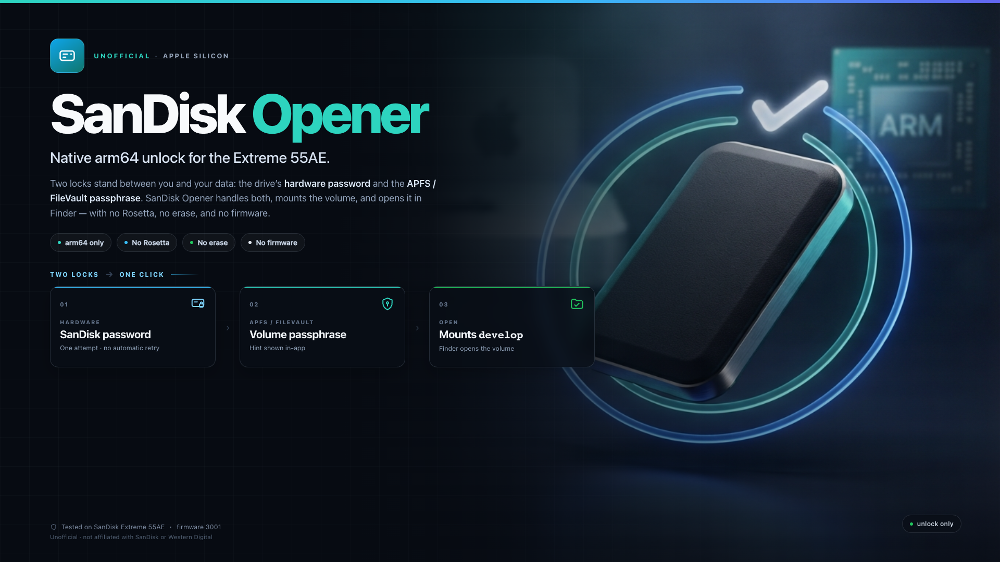

# SanDisk Opener



Native Apple Silicon unlock for the **SanDisk Extreme 55AE**. Opens the
hardware-encrypted drive and its APFS volume in Finder — without Rosetta.

## Why

SanDisk's macOS unlocker is Intel-only, and Rosetta is removed in macOS 28.
The current WD Security build is still `x86_64`. Public firmware updates cover
only the V2 drives, and firmware would not replace the host unlocker.

## Features

- Native arm64 SwiftUI app. No Rosetta.
- Handles both locks: the SanDisk hardware password and the APFS/FileVault
  passphrase.
- Shows both password hints.
- One hardware unlock attempt per run; no automatic retry.
- Unlock only: no erase, format, password change, DEK reset or firmware.
- CLI for recovery and scripting.

## Requirements

- Apple Silicon Mac, macOS 13 or later.
- SanDisk Extreme 55AE (`SDSSDE60`), firmware `3001` (tested).
- An APFS volume; the app remembers the volume name.

## Install

Download the latest release, or build from source:

```sh
./build.sh
./build-app.sh
open "SanDisk Opener.app"
```

The app is ad-hoc signed. On first launch, right-click → **Open** if Gatekeeper
asks.

## Usage

Double-click **`Open Develop.command`**, or run:

```sh
./sandisk-unlock unlock
```

The app checks the hardware lock, reads the hints, unlocks APFS if needed,
mounts the volume, and opens Finder.

## Troubleshooting

If the volume does not appear, the APFS layer is still locked:

```sh
diskutil apfs list
diskutil apfs unlockVolume diskXsY
```

Use the current disk identifier; numbers change after reconnecting. Never
choose **Initialize** or **Erase** when macOS says the disk is unreadable.

## Safety

- One hardware attempt per run; five wrong attempts can force an erase.
- Back up before any erase or firmware update.
- The tool never writes the data area.

## Compatibility

| | |
|---|---|
| Drive | SanDisk Extreme 55AE (`SDSSDE60`), firmware `3001` |
| Mac | Apple Silicon, macOS 13+ |
| App | arm64, ad-hoc signed |
| Volume | APFS, configurable in the app |

## Project

- `app/SanDiskOpener.swift` — SwiftUI app
- `sandisk-unlock.c` — CLI
- `build.sh`, `build-app.sh`
- `docs/hero.png` — infographic

## License

MIT. See [LICENSE](LICENSE).

## Disclaimer

Unofficial. Not affiliated with SanDisk or Western Digital. SanDisk and Extreme
are trademarks of their respective owners. Apple, Apple Silicon, macOS and ARM
are trademarks of their respective owners. Use at your own risk.
